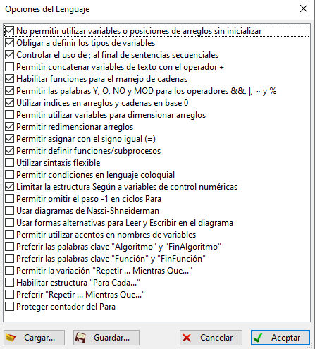

# Ejercicio de PseInt

[Video completo con 50 ejercicios para practicar](https://youtu.be/WW9cn-bdVlQ)

| N°  |                                                                                                                                                                                                                                       Ejercicios                                                                                                                                                                                                                                       |
| :-: | :------------------------------------------------------------------------------------------------------------------------------------------------------------------------------------------------------------------------------------------------------------------------------------------------------------------------------------------------------------------------------------------------------------------------------------------------------------------------------------: |
|  1  |                                                                                                                                                                                                                          Escribe por pantalla "¡Hola mundo!"                                                                                                                                                                                                                           |
|  2  |                                                                                                                                                                                               Pide un nombre por teclado y muestra el siguiente mensaje:  ¡Bienvenido \<tu_nombre\>!                                                                                                                                                                                               |
|  3  |                                                                                                                                                                                         Crea dos variables numéricas y realiza las operaciones de  suma, resta, multiplicación y división.                                                                                                                                                                                         |
|  4  |                                                                                                                                                                                                 Pide el precio de un producto,  obtén el valor del IVA y su valor final. IVA = 21%                                                                                                                                                                                                 |
|  5  |                                                                                                                                                                                                              Pide dos números enteros e indica cuál de los dos es mayor.                                                                                                                                                                                                               |
|  6  |                                                                                                                                                                                       Pide dos números enteros e indica cuál de los dos es mayor,  en caso de ser iguales, indícalo también.                                                                                                                                                                                       |
|  7  |                                                                                                                                                                                        Pide un número e indica si es divisible con 2, es decir,  que la división con 2 no queden decimales.                                                                                                                                                                                        |
|  8  |                                                                                                                                                                                                Pide un número de mes y devuelve su equivalente en palabra.  Por ejemplo, 3 -> Marzo                                                                                                                                                                                                |
|  9  |                                                                                                                                                                                                                    Muestra los números del 1 al 10 usando Mientras.                                                                                                                                                                                                                    |
| 10  |                                                                                                                                                                                                                      Muestra los números del 1 al 10 usando Para.                                                                                                                                                                                                                      |
| 11  |                                                                                                                                                                                                                    Muestra los números del 1 al 10 usando Repetir.                                                                                                                                                                                                                     |
| 12  |                                                                                                                                                                                                        Muestra los números divisibles entre 2 y 3 de los 100 primeros números.                                                                                                                                                                                                         |
| 13  |                                                                                                                                                                                                        Muestra los números divisibles entre 2 o 3 de los 100 primeros números.                                                                                                                                                                                                         |
| 14  |                                                                                                                                                                                                               Valida que el número introducido por teclado sea positivo.                                                                                                                                                                                                               |
| 15  |                                                                                                                                                                                                     Valida que el número introducido por el teclado esté entre 0 y 10 (inclusive).                                                                                                                                                                                                     |
| 16  |                                                                                                Introduce una nota entre 0 y 10 (inclusive) e indica la valoración  de la nota siguiendo el siguiente criterio:  _ Entre 0 y 4: Insuficiente   _ Si es igual a 5: Suficiente   _ Entre 6 y 7: Bien   _ Si es igual a 8: Notable  \* Entre 9 y 10: Sobresaliente                                                                                                 |
| 17  |                                                                                                                                                                                                                      Muestra 10 números aleatorios entre 0 y 100.                                                                                                                                                                                                                      |
| 18  |                                                                                                                                                                                                       Pide una palabra por teclado y muestra el número de caracteres que tiene.                                                                                                                                                                                                        |
| 19  |                                                                                                                                                                                                          Pide una palabra por teclado y muéstrala en mayúsculas y minúsculas.                                                                                                                                                                                                          |
| 20  |                                                                                                                                                                                                                 Pide una palabra por teclado y recorre cada carácter.                                                                                                                                                                                                                  |
| 21  |                                                                                                                                                                                                                  Pide una palabra por teclado y elimina los espacios.                                                                                                                                                                                                                  |
| 22  |                                                                                                                                                                                                                 Pide un número e indica el número de cifras que tiene.                                                                                                                                                                                                                 |
| 23  |                                                                                                                                                                                                                               Crea un menú de opciones.                                                                                                                                                                                                                                |
| 24  |                                                                                                                                                                                                         Crea un arreglo de 10 posiciones e introduce los valores del 1 al 10.                                                                                                                                                                                                          |
| 25  |                                                                                                                                                                                                   Crea un arreglo de 10 posiciones e introduce los valores aleatorios entre 0 y 100.                                                                                                                                                                                                   |
| 26  |                                                                                                                                               Crea un arreglo de 10 posiciones y pide un número,  almacena en el arreglo la tabla del 10 de ese número. Muéstralo con el siguiente formato: 5 x 1 = 5 5 x 2 = 10 ...                                                                                                                                               |
| 27  |                                                                                                                                                                Crea un arreglo con los valores del 1 al 5. Crea un segundo arreglo con los valores invertidos del primero. Por ejemplo: 1,2,3,4,5 => 5,4,3,2,1                                                                                                                                                                 |
| 28  |                                                                                                                                                                                        Crea un arreglo y rellénalo con 10 notas entre 0 y 10,  y cuenta cuántos suspensos y aprobados hay.                                                                                                                                                                                         |
| 29  |                                                                                                                                                                                   Crea un arreglo de 10 posiciones y rellénalo con números aleatorios. Busca cuál es el número mínimo y máximo.                                                                                                                                                                                    |
| 30  |                                                                                                                                                                         Crea un arreglo de 10 posiciones, rellénalo con números aleatorios,  pide un número por teclado e indica si existe en el arreglo.                                                                                                                                                                          |
| 31  |                                                                                                                                                                Crea un arreglo de 10 posiciones, rellénalo con números aleatorios  y pide un número por teclado. Indica cuántas veces se repite en el arreglo.                                                                                                                                                                 |
| 32  |                                                                                                                                                                                    Crea un arreglo de 6 posiciones y genera 6 números aleatorios entre 1 y 49. Los números no deben repetirse.                                                                                                                                                                                     |
| 33  |                                                                                                                                                                      Crea 2 arreglos y fusiónalos en uno nuevo. Los arreglos deben tener diferente longitud. Rellena los arreglos con números aleatorios.                                                                                                                                                                      |
| 34  |                                                                                                                                                                                                     Ordena de forma ascendente un arreglo de 10 posiciones con números aleatorios.                                                                                                                                                                                                     |
| 35  |                                                                                                                                                                        Crea un arreglo multidimensional de 3x3 con los números del 1 al 9  y muéstralo de la siguiente forma: 1 2 3 4 5 6 7 8 9                                                                                                                                                                        |
| 36  |                                                                                                                                                                                        Crea un arreglo multidimensional de 3x3,  pide una fila por teclado y suma los valores de la misma.                                                                                                                                                                                         |
| 37  |                                                                                                                                                                                       Crea un arreglo multidimensional de 3x3,  pide una columna por teclado y suma los valores de la misma.                                                                                                                                                                                       |
| 38  |                                                                                                                                                                                          Crea un arreglo multidimensional de 3x3  y suma los valores de la diagonal principal e inversa.                                                                                                                                                                                           |
| 39  |                Crea una matriz con la tabla de multiplicar del 1 al 9,  tendría que tener el siguiente aspecto: -- 01 02 03 04 05 06 07 08 09 01 01 02 03 04 05 06 07 08 09 02 02 04 06 08 10 12 14 16 18 03 03 06 09 12 15 18 21 24 27 04 04 08 12 16 20 24 28 32 36 05 05 10 15 20 25 30 35 40 45 06 06 12 18 24 30 36 42 48 54 07 07 14 21 28 35 42 49 56 63 08 08 16 24 32 40 48 56 64 72 09 09 18 27 36 45 54 63 72 81                |
| 40  |                                                                                                                                                                                                               Crea un subproceso que escriba por pantalla "¡Hola mundo!"                                                                                                                                                                                                               |
| 41  |                                                                                                                                                                                                           Crea un subproceso con un argumento llamado nombre que nos salude.                                                                                                                                                                                                           |
| 42  |                                                                                                                                                                                             Crea un subproceso que dado dos números como argumentos  los sume y retorne el resultado.                                                                                                                                                                                              |
| 43  |                                                                                                                                                                                            Crea un subproceso para validar un número que esté  entre dos números dados por argumentos.                                                                                                                                                                                             |
| 44  |                                                                                                                                                                      Crea un subproceso para validar un número que esté entre dos números dados. No debe devolver el número, debes pasárselo como referencia.                                                                                                                                                                      |
| 45  |                                                                                                                                                                                                            Crea un subproceso para mostrar un arreglo pasado por argumento.                                                                                                                                                                                                            |
| 46  |                                                                                                                                                                                                          Crea un subproceso para rellenar un arreglo con números aleatorios.                                                                                                                                                                                                           |
| 47  |                                                                                                                                                                                                              Crea un subproceso para ordenar ascendentemente un arreglo.                                                                                                                                                                                                               |
| 48  |                                                                                                                                                                                                                      Crea un subproceso para mostrar una matriz.                                                                                                                                                                                                                       |
| 49  |                                                                                                                                                                                               Crea un subproceso para rellenar una matriz  con números aleatorios entre dos números.                                                                                                                                                                                               |
| 50  | Vamos a gestionar las ventas de un mes con una matriz de 5x7,  tendremos un menú con las siguientes opciones: _ Añadir venta: pedimos un día, calculamos la coordenada exacta y añadimos la venta.  En caso de que ya exista una venta, la sumamos. _ Total de ventas: Mostramos el total de ventas. _ Total de ventas en una semana: Pedimos una semana y sumamos las ventas de esa semana. _ Mostrar ventas: Mostramos la matriz de las ventas. \* Salir |
